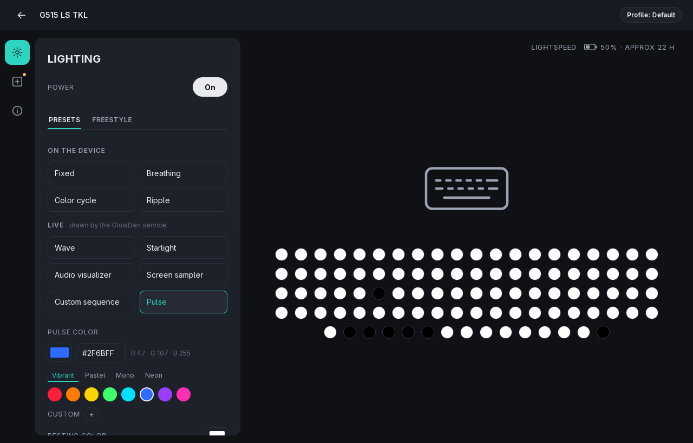
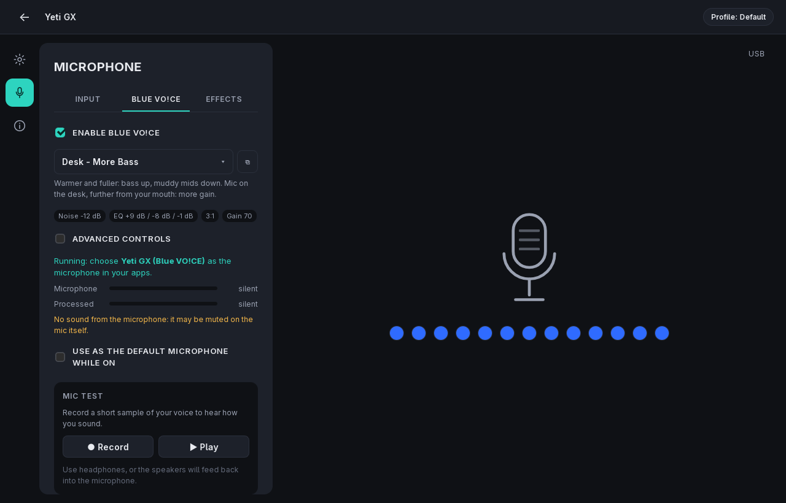
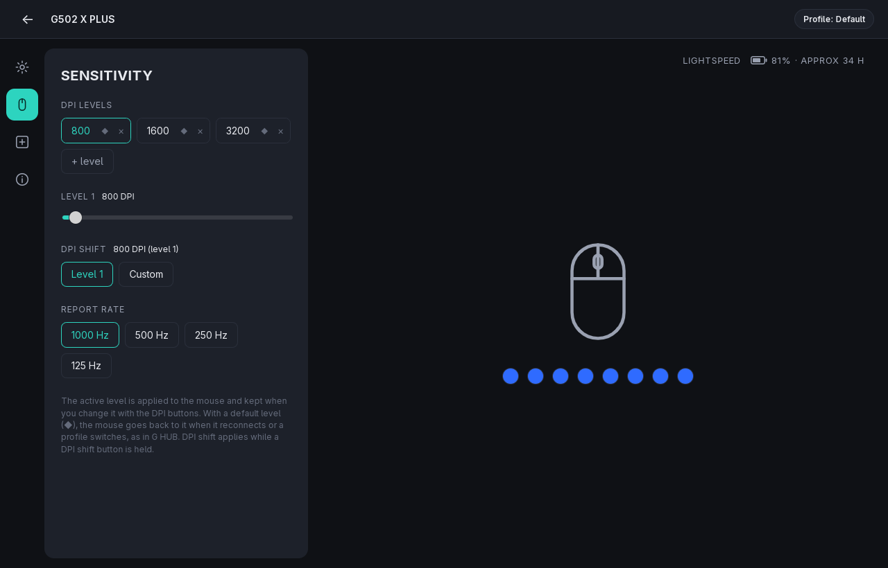
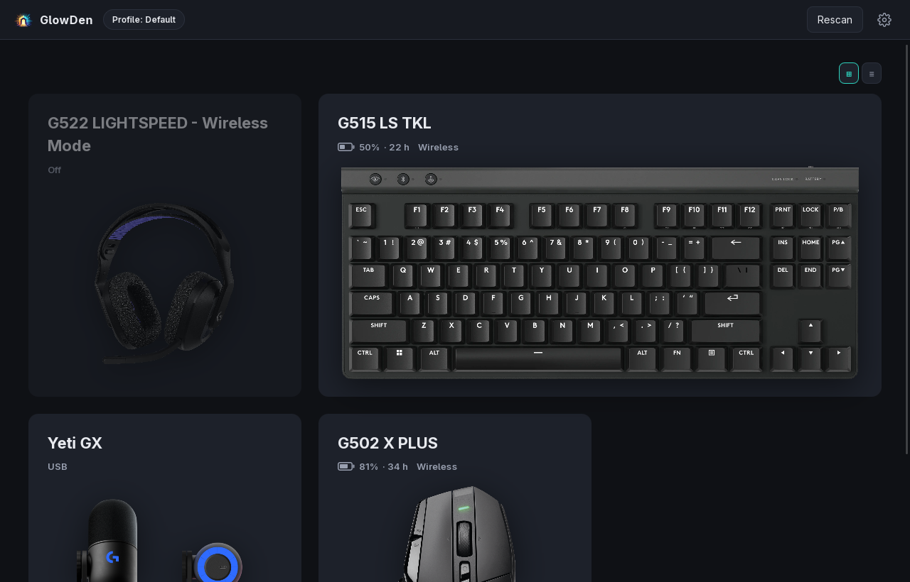
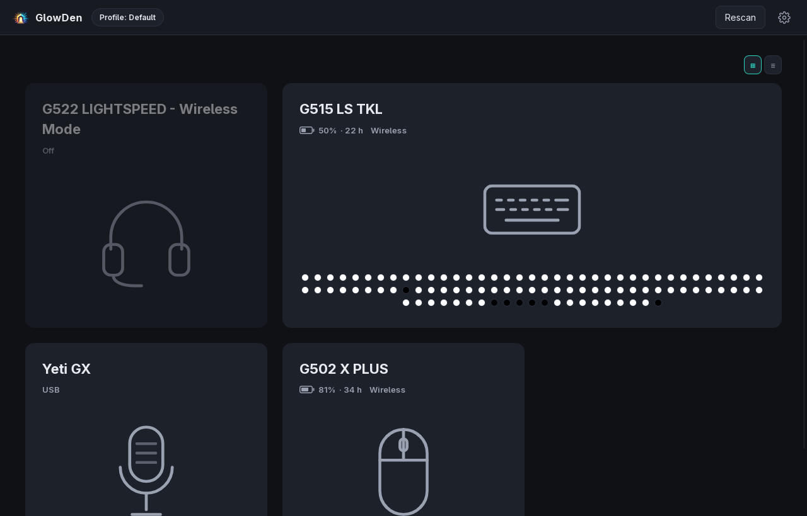

<p align="center"></p>

# GlowDen

An open device hub for Logitech G peripherals on Linux: lighting, buttons, DPI, profiles,
microphone and headset settings, kept applied by a background service, with a desktop app.
No Wine.

GlowDen is a framework. This repository is the engine (service, desktop app, HID++
protocol); what it knows about each device comes from device sources
([glowden-devices](https://github.com/larryGF/glowden-devices) is built in), and the
assets come from you: pictures, sound clips, VO!CE presets and the optional Blue VO!CE
engine are read from G HUB files you point it at. Nothing from Logitech or DTS is part of
this repository or its packages. GlowDen is not affiliated with Logitech; see
[`NOTICE.md`](NOTICE.md).

## What it does

- **Lighting**: device effects, per-key painting, live effects drawn by the service (wave,
  pulse, starlight, audio visualizer, screen sampler, custom sequences), brightness, sync
  across devices, saved presets.
- **Mice**: DPI levels with a default level and a DPI shift, report rate, button
  assignments (keys, macros, media and desktop actions, programs, sounds), left-handed mode.
- **Microphones**: gain, mute, Blue VO!CE presets and fine-tuning, G HUB's voice effects,
  level meter, preset test on a recording (Yeti GX; VO!CE needs the user's own engine).
- **Profiles** per application (switch with the focused window on KDE Plasma, GNOME and Hyprland), backups,
  tray icon, low-battery and lock-key notifications, start on login.

## Screenshots

| | |
|---|---|
|  |  |
| Lighting: device effects and live effects drawn by the service | Blue VO!CE with your own engine, presets and level meters |
|  |  |
| DPI levels, DPI shift and report rate | With G HUB files added in Settings: device pictures and live LED preview |

### Without G HUB files

You don't need Windows or G HUB to use GlowDen. Lighting, brightness, DPI, report rate,
button assignments, profiles and battery levels work with only the device definitions
GlowDen downloads by itself. What comes from G HUB's files, and is missing without them:

- device pictures and the live LED preview drawn on them (a generic icon is shown instead;
  some definitions point at a public product photo);
- Blue VO!CE, its presets and the voice effects (they run on DTS's engine from those files);
- sound clips for button assignments;
- battery hours left (the percentage still shows).



Per-app profile switching follows the focused window on KDE Plasma, GNOME (through the
GlowDen focus extension the packages install; log out and in once after installing) and
Hyprland.

Tested with a G515 LS TKL keyboard, a G502 X PLUS mouse, a Yeti GX microphone and a G522
headset (detection and battery only so far). Port status against G HUB:
[`docs/FEATURES.md`](docs/FEATURES.md); current state: [`docs/STATUS.md`](docs/STATUS.md).

## G HUB feature map

What has been ported from G HUB so far. ✅ works, checked on the hardware above ·
🟡 built, not yet checked on hardware · ⏳ planned · ➖ not applicable on Linux. The full
inventory with protocol notes is in [`docs/FEATURES.md`](docs/FEATURES.md).

| Area | G HUB feature | GlowDen |
|---|---|---|
| **Devices** | Detection (USB, LIGHTSPEED receivers, headset dongle) | ✅ |
| | Battery level and charging | ✅ keyboard, mouse · 🟡 headset |
| | Settings kept applied in the background, re-applied on reconnect | ✅ `glowdend` service |
| | Device pictures with live LED overlay | ✅ from your G HUB files |
| | Receiver pairing | ⏳ |
| | Firmware updates | ➖ left to G HUB on purpose |
| **Lighting** | Fixed, breathing, color cycle | ✅ |
| | Brightness | ✅ |
| | Per-key painting (freestyle) | ✅ |
| | Animated effects | ✅ wave, starlight, pulse · 🟡 audio visualizer |
| | Screen sampler | 🟡 through the desktop's screen-sharing portal |
| | LIGHTSYNC (same effect on every device) | ✅ |
| | Custom effects, saved presets, import/export | 🟡 custom sequences and My presets |
| | Firmware effects (G515 ripple) | ✅ ripple · ⏳ other firmware effects |
| | Lights off when the session locks | 🟡 |
| | Low-battery lighting | 🟡 |
| | Lights off after inactivity, power-saving effect | ⏳ |
| | Games controlling the lighting (LED SDK) | ⏳ |
| **Mouse** | DPI levels, default level, DPI shift | 🟡 |
| | Report rate | ✅ |
| | Button assignments (keys, macros, media, programs, sounds) | 🟡 |
| | Left-handed mode | 🟡 |
| | Separate X/Y DPI, DPI tester, onboard memory | ⏳ |
| **Keyboard** | Per-key lighting | ✅ |
| | Key remapping, G-shift, game mode, onboard profiles | ⏳ |
| **Headset** | Battery | 🟡 |
| | Sidetone, equalizer, mic processing, auto sleep, lighting | ⏳ |
| **Microphone** | Gain, mute, lighting | ✅ |
| | Blue VO!CE presets and fine-tuning | 🟡 with the engine from your G HUB files |
| | Voice effects (21 presets) | 🟡 |
| | Mic test: record a sample, hear it looped while you change settings | 🟡 |
| | Custom presets and effects (duplicate, rename, delete) | 🟡 |
| | Level meter | 🟡 |
| | Automatic gain control | ⏳ |
| **Profiles** | Per-app profiles with automatic switching | 🟡 KDE Plasma, GNOME, Hyprland |
| | Profile import/export, settings backups | 🟡 |
| | Sound clips on buttons | 🟡 from your G HUB files |
| | System actions library | 🟡 |
| | Lua scripting | ⏳ |
| **App** | Tray with battery and profile switching | 🟡 |
| | Start on login, low-battery and lock-key notifications | 🟡 |
| | Home grid/list layout | ✅ |
| | Languages other than English | ⏳ |
| | Accounts, community, game library, analytics | ➖ |

## Install

Download the package for your system from the
[latest release](https://github.com/larryGF/glowden/releases/latest):

**Arch Linux and derivatives**

```sh
sudo pacman -U glowden-<version>-1-x86_64.pkg.tar.zst
```

**Debian 12+, Ubuntu 22.04+ and derivatives**

```sh
sudo apt install ./glowden_<version>_amd64.deb
```

Both install the app (`glowden`, also in your app menu as GlowDen), the service
(`glowdend`), the CLI (`glowdenctl`), a udev rule giving the logged-in user access to
Logitech devices, and a systemd user unit. If a device doesn't show up right after
installing, replug it once so the udev rule applies to it.

**Requirements**: PipeWire as the sound server for Blue VO!CE, voice effects and the audio
visualizer (default on Arch, Debian 12 desktops and Ubuntu 22.10+; on Ubuntu 22.04 install
`pipewire-pulse`). Per-app profiles follow the focused window on KDE Plasma, GNOME and Hyprland. The screen
sampler needs `xdg-desktop-portal`.

### First start

1. Open **GlowDen**. It starts the service if it isn't running; to keep it running from
   login, turn on *Start the GlowDen service when you log in* in Settings (or
   `systemctl --user enable --now glowdend`).
2. **Settings → Device sources**: the built-in source installs definitions for your devices
   automatically when they connect. Devices that need a plugin (Blue VO!CE on the Yeti GX)
   work after you choose *Allow plugins* for that source.
3. **Settings → G HUB files** (optional): add a folder with G HUB's files to get device
   pictures, sound clips, the VO!CE presets and its engine. On a dual-boot machine, mount
   the Windows drive and add it; GlowDen looks in the right places on it. Any folder holding
   the files works too. GlowDen reads them where they are and never copies them; what you
   point it at, and under which terms you got it, is your responsibility.

### Uninstall

`sudo pacman -R glowden` or `sudo apt remove glowden`. Your settings stay in
`~/.config/glowden`; downloaded definitions and plugins in `~/.local/share/glowden`.

## Build from source

Requires the Rust toolchain, Node 20+ with pnpm, and the WebKitGTK 4.1, GTK 3, PipeWire,
libsystemd and D-Bus development packages.

```sh
cargo build --release -p glowdend -p glowden-cli -p glowden-sampler
cd app && pnpm install && pnpm tauri build   # desktop app, after the cargo build
```

Binaries land in `target/release/`. Packages from a checkout: `makepkg -si` in
`packaging/arch`, or `packaging/deb/build.sh` (Docker; builds in Ubuntu 22.04 so the .deb
runs on Ubuntu 22.04+ and Debian 12+). Without a package, install the udev rule yourself:

```sh
sudo install -Dm644 packaging/udev/70-glowden.rules /usr/lib/udev/rules.d/70-glowden.rules
sudo udevadm control --reload-rules
sudo udevadm trigger --subsystem-match=hidraw --subsystem-match=input --subsystem-match=misc --action=change
```

## Use

- `glowden` is the desktop app; closing its window keeps it in the tray.
- `glowdend` keeps every device's settings in `~/.config/glowden/config.json` and re-applies
  them when a device connects or wakes. Live effects keep running without the app.
- `glowdenctl` inspects devices: `glowdenctl list`, `glowdenctl <device> effects`;
  `GLOWDEN_DEBUG=1 glowdenctl …` prints every HID++ frame.

## Layout

| Path | What |
|---|---|
| `crates/hidpp` | HID++ 2.0 over hidraw, headset (centurion) transport, device features |
| `crates/lighting` | Key layout, per-key streaming, effects, audio analyzer, screen capture client |
| `crates/daemon` | `glowdend`: device workers, config, device sources, G HUB files, plugins, socket API |
| `crates/cli` | `glowdenctl` |
| `crates/sampler` | `glowden-sampler`: screen colors through the ScreenCast portal |
| `app` | Tauri + Svelte desktop app (a client of `glowdend`) |
| `packaging` | udev rule, systemd unit, desktop entry, Arch and Debian packaging |
| `docs` | Feature inventory and status |

## Contributing

See [`CONTRIBUTING.md`](CONTRIBUTING.md). Device definitions and plugins go to
[glowden-devices](https://github.com/larryGF/glowden-devices).

## License

Licensed under either of [MIT](LICENSE-MIT) or [Apache-2.0](LICENSE-APACHE), at your
option. Files you use from G HUB stay under Logitech's and DTS's terms; see
[`NOTICE.md`](NOTICE.md).
